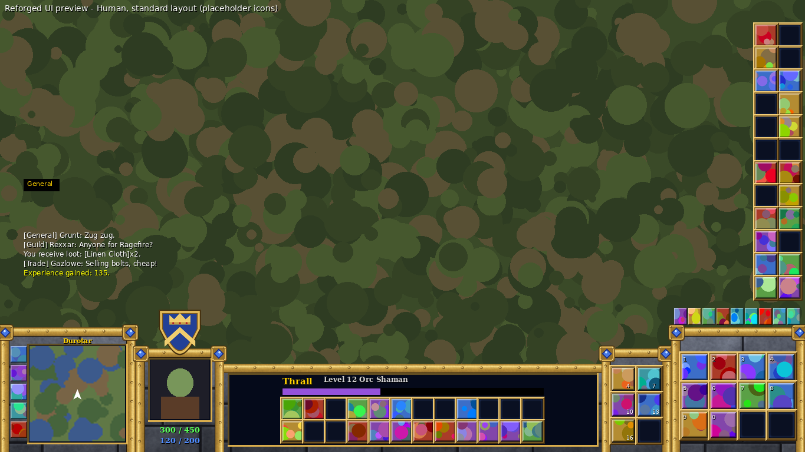

# Reforged UI

A World of Warcraft: Forever addon that replaces the bottom of the screen with a
console in the style of the Warcraft III: Reforged UI, themed for the Human,
Orc, Undead and Night Elf factions.



## What it does

- **Command card**: the main action bar as a 4x3 grid on the right, following
  stance, form, stealth and possess paging.
- **Info screen**: name, level, class and experience bar, with action bars 2 and 3.
- **Portrait**: animated 3D player portrait with hit points and mana below it.
- **Inventory**: the 2x3 inventory grid holds the backpack and bag slots.
- **Square minimap** on the left, with tracking, calendar, mail, addon and
  landing page buttons stacked beside it and mouse-wheel zoom.
- **Chat, micro menu, stance/pet bars, cast bar, extra action button, vehicle
  bar, quest tracker and bag windows** are moved so they sit around the console.
- Key bindings for the Blizzard action bars carry over to the new buttons.

## Screen shapes

The layout is picked from your screen's aspect ratio (`/rui layout` overrides it):

| Layout | Screens | Chat | Bars 4 and 5 |
| --- | --- | --- | --- |
| `16:9` (standard) | 16:9, 16:10, 4:3 | Above the minimap | Right screen edge |
| `21:9` (wide) | 21:9 | Inside the console | Right screen edge |
| `32:9` (superwide) | 32:9 | Inside the console | In the console wings |

On 32:9 the console core keeps a 21:9 width in the middle of the screen so
nothing important sits in your peripheral vision; the wings on either side
carry the art and action bars 4 and 5.

| 21:9 Night Elf | 32:9 Orc |
| --- | --- |
|  |  |

The previews are rendered from the real layout code and textures, with
placeholder icons, portrait, minimap and chat.

## Themes

`auto` (the default) picks a theme from your race: Human, Dwarf and Gnome use
Human; Night Elf uses Night Elf; Orc, Troll and Tauren use Orc; Undead uses
Undead. Change it any time with `/rui theme`.

## Commands

```
/rui theme auto|human|orc|undead|nightelf
/rui layout auto|16:9|21:9|32:9
/rui scale 0.5-1.5
/rui module <actionbars|minimap|chat|unitinfo|inventory|blizzard> on|off   (then /reload)
/rui status
/rui reset
```

## Install

Copy the `ReforgedUI` folder into `World of Warcraft\_classic_\Interface\AddOns`
(or the AddOns folder of your Forever install) and reload.

## Art

The textures are original procedural stand-ins for the Reforged console art,
generated by `tools/gen_textures.py`. To use other art, drop files with the same
names into `ReforgedUI/Media/<Faction>/`; see [Media/README.md](ReforgedUI/Media/README.md).

## Development

- `luacheck ReforgedUI` lints the addon.
- `lua5.1 tools/smoke_test.lua` loads the addon against a stubbed game API and
  exercises login, every layout and theme, combat queuing and the main events.
- `python3 tools/gen_textures.py` regenerates the textures.
- `python3 tools/render_preview.py` re-renders the previews in `docs/previews`.
