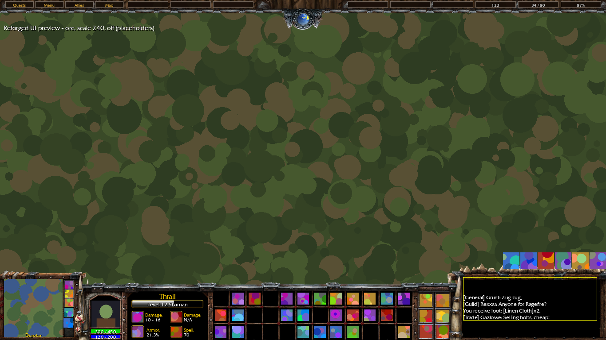
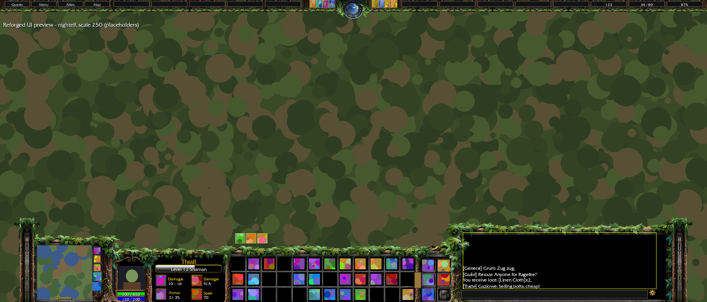
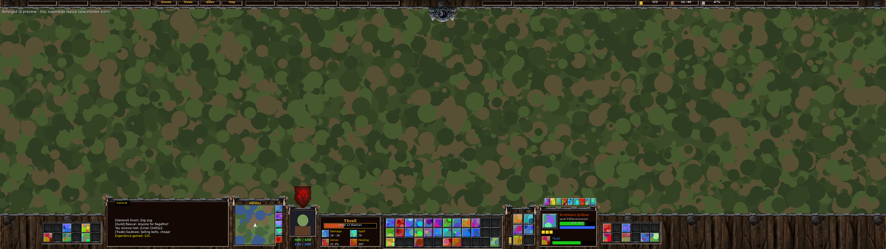
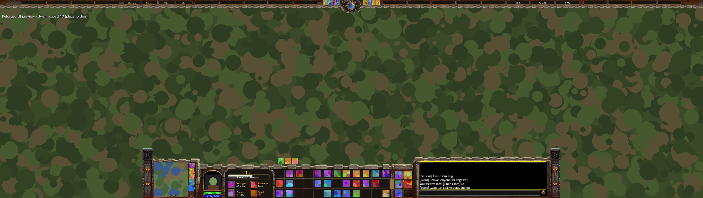
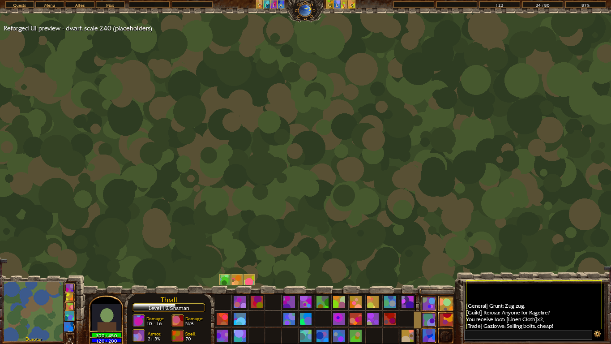
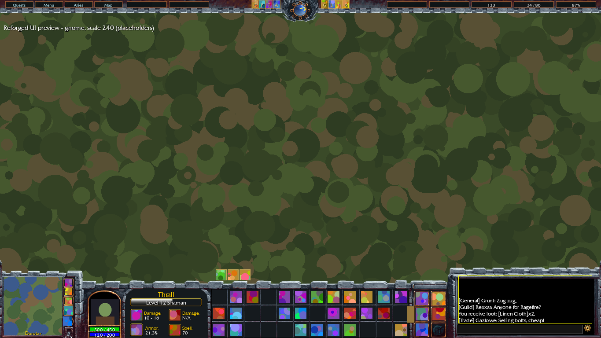
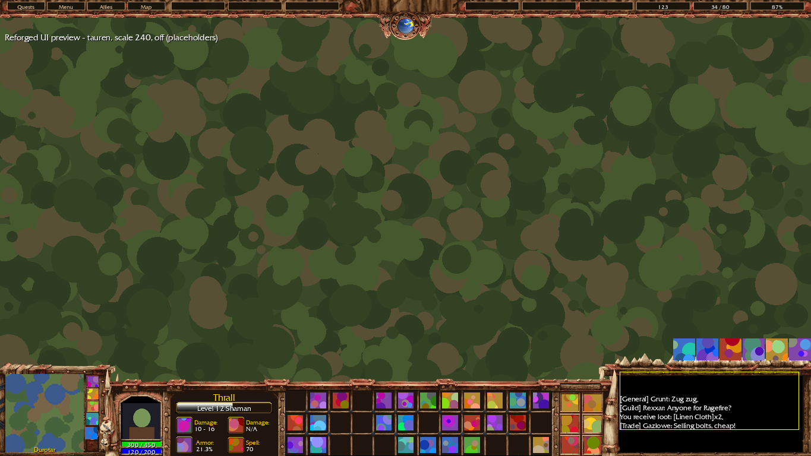
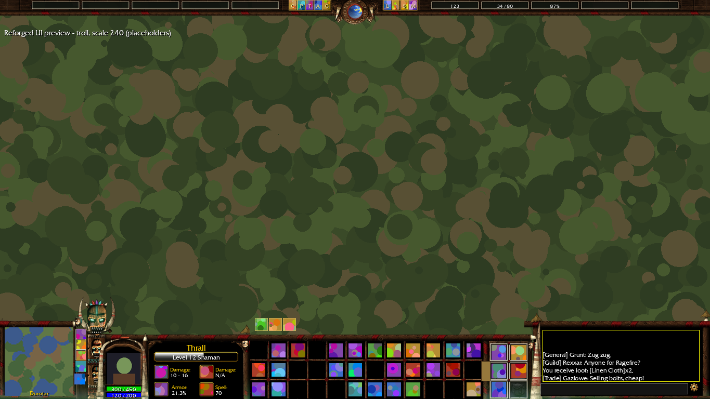
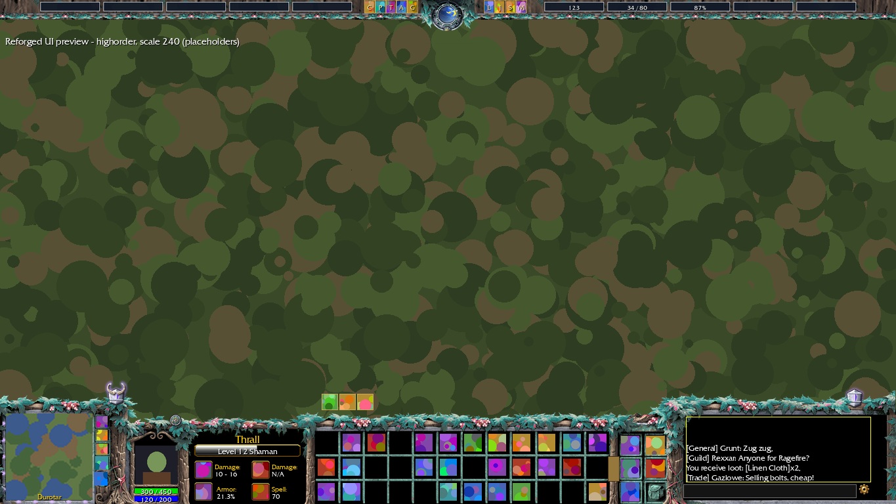
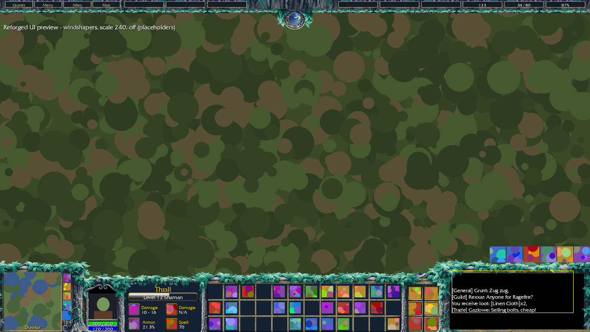

# Reforged UI for WoW: Forever

A World of Warcraft: Forever addon that replaces the bottom of the screen with
the Warcraft III console, with a theme for every playable race: Human, Dwarf,
Gnome, Night Elf, Orc, Tauren, Troll, Undead (Forsaken or Scourge) and
Skyborne (High Order and Windshapers).

The console is a port of a WoW 1.12 console addon: its layout, art, fonts and options menu,
rebuilt for the current engine (Edit Mode, secret values, protected frames).
All console art and the font in `ReforgedUI/art` are the original addon's. Reforged UI
adds the top bar with the day/night clock and data broker feeds.



## What it does

Left to right, as in the original addon with its "Center UI" option, which is always on:
the console sits in the middle of the screen with the original addon's chat width (on a
16:9 screen it fills the width, on 21:9 and 32:9 screens the rest of the
screen stays free on either side).

- **Minimap block**: a square minimap with mouse-wheel zoom, the zone name on
  its bottom or top edge, the tracking button in the round slot below it, the
  mail slot (a grey letter when there is no mail) and three action slots
  beside it. Other addons' minimap buttons go in a compartment: click the bag
  just above the map's top-right corner to open or close a flyout of them
  (Blizzard's own buttons line up along the top edge of the map); the minimap's day/night indicator is hidden (the top bar has the
  clock).
- **Portrait block**: animated 3D portrait (click to target yourself,
  right-click for your menu), health and power bars under it, rest/combat,
  group leader and PvP icons. The background pulses red under the low health
  threshold.
- **Hero screen**: name, level and class, the experience bar with rested
  experience (hover for the numbers, right-click for its colour: purple,
  blue or none) and four stat icons. Each shows main hand, off hand (block
  chance and value with a shield), ranged, ammo (yellow under 400, red under
  200), spell power, healing, armour (the default for the fourth),
  strength, agility, intellect (with Warcraft III's hero attribute art),
  crit chance (the best of melee, ranged and spell, with the Blademaster's
  Critical Strike icon) or nothing (an empty socket), chosen per class from each icon's right-click menu
  or the options menu. Druid forms and Ghost Wolf swap
  the icons like the original addon.
- **Target**: by default the hero screen switches to your target, as
  selecting a unit in Warcraft III: its portrait, name (coloured by reaction
  or class), level and classification, health and power bars with numbers,
  your combo points and its cast bar. Your own bars under the portrait stay
  yours; clearing the target brings your hero back. "Wall plate" in the
  options (or `/rui target plate`) instead puts the target in a small
  portrait arch standing on the wall above the stats panel. Either way the
  target's target is a small unit icon above the portrait (blue when it is
  you, else green, yellow or red), with the target's buffs and debuffs
  beside it (above the plate in plate mode). Those are Blizzard's own aura
  icons: in combat the game lets no addon read a target's auras, so
  Blizzard's target frame stays with everything but its auras made
  invisible, and the "Reforged UI" Edit Mode layout places it (buffs on
  top) so the icons land there.
  Left-click targets, right-click opens the unit menu.
  For the target's health nearer the middle of the screen, the options'
  "Target bar" (or `/rui targetbar on`) adds a small free-standing bar with
  its name, level, health and power, in either mode. It is click-through
  until you hold Shift out of combat (or open Edit Mode), then drag it anywhere; its place
  is saved on its own and never touches the Edit Mode layout.
- **Action grid**: action bars 1-3, twelve slots each. These are Blizzard's
  own buttons, moved into the grid and reskinned, so bindings, paging,
  cooldowns and proc glows work as usual. The stance buttons (Paladin auras,
  Warrior stances, Druid forms, ...) stand in a row on the wall above the grid,
  as in Warcraft III; these are Blizzard's buttons too. The pet bar starts in a
  row just above them (on their row, for classes without stances), at about
  their size, and is Blizzard's Edit Mode bar, so you can move and resize it
  in Edit Mode.
- **Inventory**: the bags in the 2x3 inventory (backpack top-left, bags 1-4,
  reagent bag bottom-right where the client has one) with the key ring to its
  right, under the chat buttons. Clicks go through Blizzard's own bag buttons, so bag addons such as
  BetterBags open as usual; drag a bag onto a slot to equip it.
- **Chat area**: the main chat window and its input box fill the black area
  at the right end of the console, which can be raised. The options
  cogwheel sits in its bottom-right corner.
- **End caps**: a pillar in the theme's style closes each end of the
  console, since it always stands in mid-screen. On 21:9 the chat area
  narrows a little where it needs to for both to fit; on 16:9 they are past
  the screen edges.
- **Top bar** (Reforged UI): the day/night clock in the middle (with a
  capsule under it showing the server or local time, 24 or 12 hour, or
  hidden, set in the options) with
  Blizzard's micro buttons either side of it (character, professions,
  talents, group finder, collections, ... in Blizzard's order, then Legacy
  and the game menu to close the row; no quest log, social or map buttons,
  which have their keys, and no adventure guide or shop), and slots for
  LibDataBroker feeds, the same distance either side of the centre and out
  to the screen edges: gold, bag space and durability fill the first three
  (right of the clock; hover the gold for every character's gold and a total
  per faction, Horde and Alliance apart). Our ping and FPS feed shows world
  latency on the left of its slot and the framerate on the right (hover it for
  home latency and bandwidth); a zone feed shows where you are, coloured by
  PvP status like the minimap's. Right-click an empty
  slot (Alt-right-click a filled one) to choose any feed, or one of the
  game's own panels (character, spellbook, talents, skills, quest log,
  social, guild, world map, game menu, ...: whichever the client has),
  shown by name in the theme's menu font and colour. A panel's slot opens it with a secure click on Blizzard's micro button for
  it, so it opens untainted and in combat too. The micro buttons
  are Blizzard's own, moved and scaled to the bar, so their tooltips, alerts
  and disabled states work as usual; the micro menu itself stays empty and
  click-through wherever Edit Mode puts it. **Hide top bar** in the menu (or
  `/rui topbar off`) takes the bar away, clock and slots too; the micro
  buttons then stand on the minimap block's wall, the lower row half over
  it, between the left end cap and the addon compartment's button (in two
  or three rows where one would make them too small), and the buffs move
  up to the screen's top edge.

The three action slots beside the minimap are the first three buttons of
Blizzard's **Action Bar 8**, so they bind like any other bar (Key Bindings >
Action Bars > Action Bar 8). The addon turns on Action Bars 2, 3 and 8 once per
character; if you turn bar 8 off later, the slots are empty sockets whose
tooltip says how to turn it back on.

Buffs and debuffs are held in the top-right corner just below the top bar
(at the screen's top edge with the top bar hidden).
Other frames that Edit Mode manages (cast bar, focus and party
frames, quest tracker) stay wherever Edit Mode puts them: place them around
the console there. Moving them from addon code breaks Blizzard's own code on
this client. (The stance bar's own frame stays put too, empty and
click-through; only its buttons move into the console.) The pet bar is placed
through the layout instead, see below.

**Edit Mode layout.** The first time each character logs in, the addon
switches it to an account-wide Edit Mode layout called "Reforged UI", made
once as a copy of the layout you were using, with the cast bar just above the
console (its default place is under it), raid-style party frames, and the
target frame placed for its aura icons (again at each login and target mode
change). When the
layout is made, the raid frame options are turned on too: class colours,
power bars for every role, debuffs, aggro highlight, incoming heals, main
tank and assist, health as a percentage. Everything lives in the layout and
the game's options, so you can change any of it, or pick another layout, in
Edit Mode. In your other layouts a cast bar still in its default place is
moved above the console too. In every layout the pet bar, while still in its
default place (over the console), starts just above the stance row on the
console wall; once you move it in Edit Mode it stays where you put it.
After any such change the addon offers a reload: Blizzard applies layout
changes made by an addon as addon code, and its party frames would otherwise
error later (for example when Edit Mode closes).

**Damage meter.** The game's own damage meter is dressed in the theme by a
second addon, *Reforged UI: Damage Meter* (`ReforgedUI_DamageMeter`), which
ships with Reforged UI and shows as its own entry in the addon list, so it can
be left unloaded. Each meter window and its breakdown get the theme's top bar
trim around them (beam and posts, mitred at the corners), a dark inset, the theme's rail
under the header and every bar, and Warcraft III's bar texture and font. It only changes
art: the meter's numbers, its settings and its place (Edit Mode) are left to
Blizzard.

**Bags.** A third addon, *Reforged UI: Bags* (`ReforgedUI_Bags`), dresses the
game's bag windows (each bag on its own, the combined backpack and the key
ring) the same way: the theme's trim around each window, a dark inset, the
theme's rail under the title and the bag's icon in Warcraft III's steel
button frame on the top-left corner, where Blizzard's round portrait was (its
menu still opens there). The items, money, search box and sorting are
Blizzard's. If you use **BetterBags**, the addon also adds a **Reforged UI**
theme to BetterBags' theme list (bag, bank and option windows, following
your Reforged UI theme as it changes); pick it in BetterBags' settings.
It is a theme for BetterBags' Sonata theme engine (BetterBags 0.5.17 and
later); with an older BetterBags, or none, that part does nothing.

## Options

Click the cogwheel in the bottom-right corner of the chat area (or type `/rui config`, or use Options > AddOns > Reforged UI). The
menu keeps the original addon's options, minus the layout ones (the centre modes, chat
area width, chat placement and hiding the bags: the console is always
centred with its chat area and inventory): theme, UI scale (240-270), extend
the chat area upwards, portrait position and scale, low health threshold,
zone text position, the time under the clock, chat input above the
chat, health and power as percentages, and hiding the grid texture and chat
icons, and hiding the top bar. (The micro buttons live in the top bar, or
above the minimap without it.)

**Let Edit Mode place action bars 1-3** (off by default) leaves bars 1-3 on
their own Edit Mode bars instead of in the grid: they are placed once over
the grid rows in the "Reforged UI" layout, at about the grid's icon size, and
from then on you can move, resize and reflow them (more rows, fewer icons) in
Edit Mode like any bar. The grid art is hidden while it is on.

**Let me move and resize the chat window** (off by default) puts the chat
window in the chat area once and then leaves it alone: unlock it from its
tab's menu (or use Edit Mode) to drag it anywhere and resize it. Its input box
follows it. Turning the option off puts it back in the chat area.

**Console transparency** (0% by default) makes the console's art
see-through, so the world shows through it: around 5-10% leaves silhouettes
visible without losing the look. Only the art fades; action buttons, icons,
the portrait, the minimap and the chat stay fully opaque. It is saved for the
whole account.

| 21:9 Night Elf | 32:9 Orc |
| --- | --- |
|  |  |



The previews are rendered from the real layout code and art, with placeholder
icons, portrait, minimap and chat.

### Themes

| Theme | Key | Art |
| --- | --- | --- |
| Human | `human` | Warcraft III (Human console) |
| Orc | `orc` | Warcraft III (Orc console) |
| Undead (Scourge) | `undead` | Warcraft III (Undead console) |
| Forsaken | `forsaken` | Warcraft III's Forsaken console, cut like the original addon's Undead set |
| Night Elf | `nightelf` | Warcraft III (Night Elf console) |
| Dwarf | `dwarf` | Human art recoloured: granite, bronze trim, forge-ember accents |
| Gnome | `gnome` | Human art recoloured: brushed steel, copper trim, teal and pink accents |
| Tauren | `tauren` | Orc art recoloured: tanned wood and hide, ochre-red bands, totem turquoise |
| Troll | `troll` | Orc art recoloured: bamboo and bone, teal patina, voodoo purple |
| Skyborne (High Order) | `highorder` | Mage colours: arcane violet leaves, frost-white blossoms, silver stone |
| Skyborne (Windshapers) | `windshapers` | Shaman colours: storm-blue leaves, ember-gold blossoms, slate stone |

| Dwarf | Gnome |
| --- | --- |
|  |  |
| **Tauren** | **Troll** |
|  |  |
| **Skyborne: High Order** | **Skyborne: Windshapers** |
|  |  |

The race themes keep their base faction's shapes and layout; only the colours
change. `tools/make_race_themes.py` makes them (see Development).

**Default theme.** `auto` (the default) picks the theme of your character's
race (`UnitRace("player")`): Human, Dwarf, Gnome, Night Elf, Orc, Tauren,
Troll and Undead (`Scourge`) each get their own; Undead characters get
Forsaken, and can pick the Scourge console instead. Skyborne is token `Skyborne`
with race id 95 ("High Order Skyborne") or 96 ("Windshaper Skyborne"); the id
picks the High Order or Windshapers theme. Without an id, the race name
("High Order", "Windshaper") or else the faction picks the variant.
Any other race gets its faction's default (Alliance: Human, Horde: Orc), and
later-expansion races take the closest theme (e.g. Dark Iron Dwarf: Dwarf).
Choosing a theme in the menu or with `/rui theme` saves it and overrides the
race default until you pick `auto` again; `skyborne` picks the Skyborne theme
of your faction. Saved themes from earlier versions keep working.

## Setting up

1. Copy the `ReforgedUI` folder (and `ReforgedUI_DamageMeter` and
   `ReforgedUI_Bags`, for the damage meter and bags skins) into the AddOns
   folder of your Forever install.
   **Restart the game client completely** (not just `/reload`): the addon has
   new files, which the game only picks up on a full restart.
2. Action Bars 2, 3 and 8 are turned on for you the first time each character
   logs in. Only the first three buttons of bar 8 are used (the slots beside
   the minimap); the rest are parked off screen, so you can set it to as few
   icons as Edit Mode allows.
3. Move the focus frame and anything else Edit Mode manages to
   where you want them around the console.

## Commands

```
/rui config                      open the options menu
/rui theme auto|human|dwarf|gnome|nightelf|highorder|orc|tauren|troll|forsaken|undead|windshapers|skyborne
/rui feeds                       list data feeds, game panels and top bar slots
/rui slot <number> <feed>|none   put a feed or game panel ("quests", "map") in a top bar slot
/rui scale 0.5-1.5               top bar scale
/rui layout auto|16:9|21:9|32:9  top bar layout
/rui topbar on|off               show or hide the top bar (menu buttons above the minimap when hidden)
/rui target swap|plate           target display: on the hero screen, or a plate on the wall
/rui targetbar on|off|reset      a movable target health and power bar (Shift-drag it, or use Edit Mode)
/rui module <console|hero|actionbars|minimap|chat|inventory|blizzard|target|topbar|config> on|off   (then /reload)
/rui status
/rui reset
```

## Not ported

Things the original addon does that have no taint-safe equivalent on this client, or that
the client now does itself:

- The **Customize** tab (moving and resizing every piece) and the eight
  custom themes.
- **Cast bar alignment**, the **buff position** option (buffs always sit under
  the top bar) and moving the **pet
  frame**: these are Edit Mode frames; place them in Edit Mode. (The stance
  buttons and the pet bar are placed, see above; the position options are not.)
- Moving Blizzard's **player status icons** (rest, combat, leader, master
  looter, PvP): replaced by our own icons in the same places (no master
  looter icon).
- The **"Center UI, no chat area"** modes, the **chat width** and **"Hide
  bags"** options: the console is always centred with its chat area and
  inventory, and the bags always show.
- **Horizontal multibars** (and their beta option), the **"Server is V+"**
  option and the **first-run reload** prompt.
- Spell and healing power **scanned from tooltips and auras**: the client's
  own spell power API is used instead.
- the original addon's **Bindings.xml**: the three extra slots use Action Bar 8's bindings.
- **Bonus action bar** handling (stances, stealth): the client pages the main
  bar by itself.
- Moving the **battleground minimap button**: it lines up with the other
  minimap buttons.
- The **chat scroll arrows** option hides the chat buttons beside the window
  instead (the client has no scroll arrows).
- Blizzard's player and target frames (and its target of target) are
  hidden: the portrait block and our target display replace them. The focus
  frame is left to Edit Mode.

## Art and licences

`ReforgedUI/art` is the original addon's art and font (the race theme folders are
recoloured copies of it) (`blq55.TTF`), cut from Warcraft III; the one `.dds` was converted to `.tga`. The top bar's
textures in `ReforgedUI/Media` are cropped from Warcraft III: Reforged (see
[Media/README.md](ReforgedUI/Media/README.md)). Blizzard owns that art, and
the console art ships without a licence file, so keep this repository private.

`ReforgedUI/Libs` embeds LibStub (public domain), CallbackHandler-1.0 (BSD) and
LibDataBroker-1.1 (public domain) for the top bar's data feeds.

## Development

- `luacheck ReforgedUI` lints the addon.
- `lua5.1 tools/smoke_test.lua` loads the addon against a stubbed game API and
  exercises login, every theme, UI scale and screen shape, the
  hero screen, combat queuing and the main events.
- `python3 tools/make_race_themes.py [race ...]` regenerates the race themes'
  art (`ReforgedUI/art/<race>` and `ReforgedUI/Media/<Race>`) from the
  the original faction art: a gradient map per material (stone, trim, accents,
  dark fills) that keeps alpha and the original's shading. Palettes are at the
  top of the script. Needs Pillow and NumPy.
- `python3 tools/make_endcaps.py [theme ...]` builds the stand-in end caps
  (`art/<theme>/endcaps/endcap_{left,right}_gen.tga`) from each theme's
  inventory pillar. Real end cap art goes in as `endcap_left.tga` /
  `endcap_right.tga` and is listed in `Layout.ENDCAP_ART` with its size and
  overlap; it then replaces the stand-ins. Dwarf (hand-built art) borrows
  Human's until its own exist.
- `python3 tools/render_preview.py` re-renders the previews in `docs/previews`
  (`tools/dump_layout.lua` prints the layout as JSON).
- `Trim.lua` is the theme frame the damage meter and bags skins put around
  Blizzard's windows (`ReforgedUI.CreateTrim`). `python3 tools/make_trim.py
  [theme ...]` makes its own art (`Media/Trim/<theme>`): the rail from each
  theme's target plate, the mitred corner where the top bar's beam and post
  meet, and side posts for themes whose top bar has none (Skyborne). The
  border itself is the top bar's trim from `Media/`.
  `python3 tools/render_damage_meter.py out.png` and
  `python3 tools/render_bags.py out.png` mock the two skins up for every
  theme.
- `Layout.lua` holds all of the original addon's placement math, free of game API calls.
