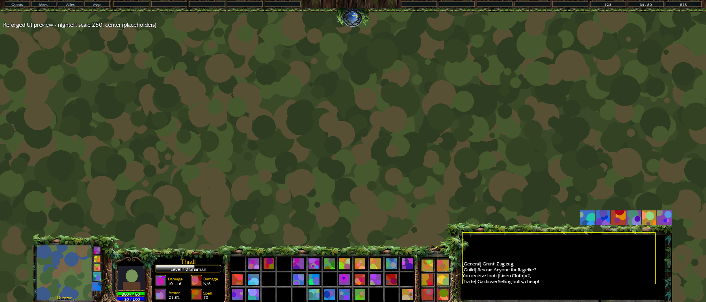

# Reforged UI for WoW: Forever

A World of Warcraft: Forever addon that replaces the bottom of the screen with
the Warcraft III console, with a theme for every playable race: Human, Dwarf,
Gnome, Night Elf, Orc, Tauren, Troll, Undead and Skyborne (High Order and
Windshapers).

The console is a port of a WoW 1.12 console addon: its layout, art, fonts and options menu,
rebuilt for the current engine (Edit Mode, secret values, protected frames).
All console art and the font in `ReforgedUI/art` are the original addon's. Reforged UI
adds the top bar with the day/night clock and data broker feeds.


## What it does

Left to right, as in the original addon:

- **Minimap block**: a square minimap with mouse-wheel zoom, the zone name on
  its bottom or top edge, the tracking button in the round slot below it, the
  mail slot (a grey letter when there is no mail) and three action slots
  beside it. Other minimap buttons (calendar, addon buttons) line up along the
  top edge of the map.
- **Portrait block**: animated 3D portrait (click to target yourself,
  right-click for your menu), health and power bars under it, rest/combat,
  group leader and PvP icons. The background pulses red under the low health
  threshold.
- **Hero screen**: name, level and class, the experience bar with rested
  experience (hover for the numbers) and four stat icons. Armour is fixed; the
  other three show main hand, off hand (block chance and value with a shield),
  ranged, ammo (yellow under 400, red under 200), spell power, healing or
  nothing, chosen per class in the options. Druid forms and Ghost Wolf swap
  the icons like the original addon.
- **Action grid**: action bars 1-3, twelve slots each. These are Blizzard's
  own buttons, moved into the grid and reskinned, so bindings, paging,
  cooldowns and proc glows work as usual.
- **Inventory**: six more action slots in the 2x3 inventory.
- **Chat area**: the main chat window and its input box in the bottom-right
  corner, which can be raised and narrowed; the bag row (backpack, bags,
  reagent bag and key ring) sits above it and by default only shows while the
  backpack is open or the mouse is over it.
- **Top bar** (Reforged UI) with Quests, Menu, Allies and Map buttons, the
  day/night clock in the middle and slots for LibDataBroker feeds: gold, bag
  space and durability fill the first three; right-click an empty slot
  (Alt-right-click a filled one) to choose any feed.

The original addon's nine "custom action buttons" (three beside the minimap, six in the
inventory) are Blizzard's **Action Bar 6**, so they bind like any other bar
(Key Bindings > Action Bars > Action Bar 6).

Frames that Edit Mode manages (cast bar, stance and pet bars, buffs, target
and party frames, quest tracker) stay wherever Edit Mode puts them: place them
around the console there. Moving them from addon code breaks Blizzard's own
code on this client.

## Options

Move the mouse to the bottom-right corner of the screen and click the
cogwheel (or type `/rui config`, or use Options > AddOns > Reforged UI). The
menu has the original addon's options: theme, UI scale (240-270), extend the chat area
upwards, chat area width, the three "Center UI" modes for wide screens,
portrait position and scale, low health threshold, rested XP colour, the stat
icons, zone text position, health and power as percentages, and hiding the
grid texture, micro buttons, chat icons and bags.

| 21:9 Night Elf, Center UI | 32:9 Orc |
| --- | --- |
|  |  |

The previews are rendered from the real layout code and art, with placeholder
icons, portrait, minimap and chat.

### Themes

| Theme | Key | Art |
| --- | --- | --- |
| Human | `human` | Warcraft III (Human console) |
| Orc | `orc` | Warcraft III (Orc console) |
| Undead | `undead` | Warcraft III (Undead console) |
| Night Elf | `nightelf` | Warcraft III (Night Elf console) |
| Dwarf | `dwarf` | Human art recoloured: granite, bronze trim, forge-ember accents |
| Gnome | `gnome` | Human art recoloured: brushed steel, copper trim, teal and pink accents |
| Tauren | `tauren` | Orc art recoloured: tanned wood and hide, ochre-red bands, totem turquoise |
| Troll | `troll` | Orc art recoloured: bamboo and bone, teal patina, voodoo purple |
| Skyborne (High Order) | `highorder` | Night Elf art recoloured: powder-blue stone, silver, arcane violet, twilight navy |
| Skyborne (Windshapers) | `windshapers` | Night Elf art recoloured: powder-blue stone, gold, storm teal, twilight navy |

| Dwarf | Gnome |
| --- | --- |
|  |  |
| **Tauren** | **Troll** |
|  |  |
| **Skyborne: High Order** | **Skyborne: Windshapers** |
|  |  |

The race themes keep their base faction's shapes and layout; only the colours
change. `tools/make_race_themes.py` makes them (see Development).

**Default theme.** `auto` (the default) picks the theme of your character's
race (`UnitRace("player")`): Human, Dwarf, Gnome, Night Elf, Orc, Tauren,
Troll and Undead (`Scourge`) each get their own. Skyborne is token `Skyborne`
with race id 95 ("High Order Skyborne") or 96 ("Windshaper Skyborne"); the id
picks the High Order or Windshapers theme. Without an id, the race name
("High Order", "Windshaper") or else the faction picks the variant.
Any other race gets its faction's default (Alliance: Human, Horde: Orc), and
later-expansion races take the closest theme (e.g. Dark Iron Dwarf: Dwarf).
Choosing a theme in the menu or with `/rui theme` saves it and overrides the
race default until you pick `auto` again; `skyborne` picks the Skyborne theme
of your faction. Saved themes from earlier versions keep working.

## Setting up

1. Copy the `ReforgedUI` folder into the AddOns folder of your Forever install.
   **Restart the game client completely** (not just `/reload`): the addon has
   new files, which the game only picks up on a full restart.
2. In Edit Mode, turn on **Action Bars 2, 3 and 6** (bar 6 can be set to 9
   icons; only nine of its buttons are used).
3. Move the cast bar, buffs, target frame and anything else Edit Mode manages
   to where you want them around the console.

## Commands

```
/rui config                      open the options menu
/rui theme auto|human|dwarf|gnome|nightelf|highorder|orc|tauren|troll|undead|windshapers|skyborne
/rui feeds                       list data feeds and top bar slots
/rui slot <number> <feed>|none   put a feed in a top bar slot
/rui scale 0.5-1.5               top bar scale
/rui layout auto|16:9|21:9|32:9  top bar layout
/rui module <console|hero|actionbars|minimap|chat|inventory|blizzard|topbar|config> on|off   (then /reload)
/rui status
/rui reset
```

## Not ported

Things the original addon does that have no taint-safe equivalent on this client, or that
the client now does itself:

- The **Customize** tab (moving and resizing every piece) and the eight
  custom themes.
- **Cast bar alignment**, the **shapeshift/aura bar position**, the **buff
  position** option and moving the **pet frame and pet bar**: these are Edit
  Mode frames; place them in Edit Mode.
- Moving Blizzard's **player status icons** (rest, combat, leader, master
  looter, PvP): replaced by our own icons in the same places (no master
  looter icon).
- **Horizontal multibars** (and their beta option), the **"Server is V+"**
  option and the **first-run reload** prompt.
- Spell and healing power **scanned from tooltips and auras**: the client's
  own spell power API is used instead.
- the original addon's **Bindings.xml**: the nine extra slots use Action Bar 6's bindings.
- **Bonus action bar** handling (stances, stealth): the client pages the main
  bar by itself.
- Moving the **battleground minimap button**: it lines up with the other
  minimap buttons.
- The **chat scroll arrows** option hides the chat buttons beside the window
  instead (the client has no scroll arrows).
- Blizzard's player frame is hidden (our portrait block replaces it); the
  target frame is left to Edit Mode.

## Art and licences

`ReforgedUI/art` is the original addon's art and font (the race theme folders are
recoloured copies of it) (`blq55.TTF`), cut from Warcraft III; the one `.dds` was converted to `.tga`. The top bar's
textures in `ReforgedUI/Media` are cropped from Warcraft III: Reforged (see
[Media/README.md](ReforgedUI/Media/README.md)). Blizzard owns that art, and
the console art ships without a licence file, so keep this repository private.

`ReforgedUI/Libs` embeds LibStub (public domain), CallbackHandler-1.0 (BSD) and
LibDataBroker-1.1 (public domain) for the top bar's data feeds.

## Development

- `luacheck ReforgedUI` lints the addon.
- `lua5.1 tools/smoke_test.lua` loads the addon against a stubbed game API and
  exercises login, every theme, centre mode, UI scale and screen shape, the
  hero screen, combat queuing and the main events.
- `python3 tools/make_race_themes.py [race ...]` regenerates the race themes'
  art (`ReforgedUI/art/<race>` and `ReforgedUI/Media/<Race>`) from the
  the original faction art: a gradient map per material (stone, trim, accents,
  dark fills) that keeps alpha and the original's shading. Palettes are at the
  top of the script. Needs Pillow and NumPy.
- `python3 tools/render_preview.py` re-renders the previews in `docs/previews`
  (`tools/dump_layout.lua` prints the layout as JSON).
- `Layout.lua` holds all of the original addon's placement math, free of game API calls.
